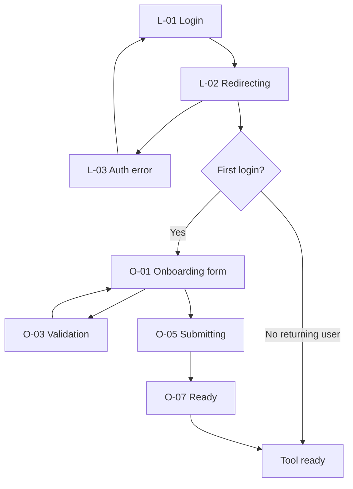

# VibeCheck — Login & First-Time Onboarding (Figma)

**Status:** Design in progress — Figma work started; role field removed from scope
**Type:** Figma design task
**Last updated:** 2026-09-22

---

## Project context

- **Product:** VibeCheck — internal Chrome extension for design feedback on prototypes
- **Repo:** design-feedback-tool (Figma is source of truth for visuals)
- **Figma file:** https://www.figma.com/design/3UduCyltV7tmRYSnDqTEfA/VibeCheck
- **Work section:** `09 · Flows · Login & Onboarding` (node `368:16017`) on Design page
- **Scope:** Figma design only — no persistence, no Okta integration, no code changes in this pass

---

## User journey (updated — no role)

1. User signs in via **Okta SSO** (VibeCheck-owned screen starts SSO; Okta hosted UI is out of scope)
2. If **first login** (profile incomplete), user sees a **single onboarding step**
3. Onboarding collects:
   - First name
   - Last name
4. After submit, the tool is ready to use
5. **Returning users** skip onboarding (product logic, not a designed screen)

> **Scope change:** Role selection was removed from the flow. Remove any role selector UI, validation, and related copy from Figma manually.

---

## Design source of truth

Reuse existing VibeCheck visual language from:

- **Main kit:** node `1:3`
- **Field components:** node `348:8892` (Form Fields section `348:8717`)
- **Do not** introduce a new visual language
- **Do not** redesign Account & Inbox Popup (`6:155`) — that remains Google SSO + Supabase config

---

## Surface decision (confirmed)

- **Extension popup** at **320px** width (matches Account popup pattern)
- Not full-page desktop frames

---

## What was built in Figma (already done)

### Kit extensions

- **Button** (`4:18`): added `Disabled` and `Loading` states for Primary + Secondary
- **Form Field** (new component set in flow section): label + Field instance + optional error message; states mirror Field (Default / Hover / Focus / Filled / Disabled / Error)
- **Form Message** (new component): inline alert with X circle icon + critical text
- **Role selector** (new component set): **TO BE REMOVED** — no longer in product scope

### Login frames (320px popup)

| ID | Frame | Purpose |
|---|---|---|
| L-01 | Login / Initial | Title “VibeCheck”, lede, Secondary CTA “Continue with Okta” |
| L-02 | Login / Redirecting | Status “Redirecting to your company sign-in…”, button Loading “Redirecting…” |
| L-03 | Login / Error | Form Message “We couldn’t sign you in. Try again.” + “Try again” button |

### Onboarding frames (320px popup)

| ID | Frame | Purpose |
|---|---|---|
| O-01 | Onboarding / Empty | Empty first/last name fields, Continue |
| O-02 | Onboarding / Filled | Names filled (e.g. Alex / Kim), Continue enabled |
| O-03 | Onboarding / Validation | Field errors: “Enter your first name” / “Enter your last name” |
| O-05 | Onboarding / Submitting | Fields disabled, “Continuing…”, button Loading |
| O-06 | Onboarding / Submit failed | Form Message “Couldn’t continue. Try again.”, values retained |
| O-07 | Onboarding / Ready | Check circle, “You’re ready”, “You can start using VibeCheck.”, “Get started” |

### Prototype connections (wired)

- L-01 → L-02 → O-01 (SSO success lands on empty onboarding)
- L-03 → L-01 (retry)
- O-01 → O-03 (validation on empty submit)
- O-02 → O-05 → O-07 (happy path)
- O-06 → O-05 (retry after failure)

### Documentation in section

- Frame labels (L-01 … O-07)
- **Annotations** block: behavior contract, accessibility notes, prototype notes

---

## Reused components & tokens

- **Field** `348:8892` — 32px input, states Default / Hover / Focus / Filled / Disabled / Error
- **Button** `4:18` — Primary / Secondary / Danger; now also Disabled / Loading
- **Icons:** Check circle `62:3922`, X circle `341:16408`
- **Typography:** Figtree — Heading/LG titles, Body/SM lede, Body/XS labels, Body/XXS errors, Heading/XS buttons
- **Colors:** VibeCheck Colors (Light) — surface, text, text-gray-medium, text-critical, button tokens
- **Spacing:** 8 / 12 / 16; field radius 12, button radius 8

---

## UI copy (approved)

### Login

- Title: `VibeCheck`
- Lede: `Sign in with your company account to continue.`
- CTA: `Continue with Okta`
- Loading: `Redirecting to your company sign-in…`
- Auth error: `We couldn’t sign you in. Try again.`
- Retry: `Try again`

### Onboarding

- Title: `Tell us who you are`
- Lede: `This helps teammates recognize you in VibeCheck.`
- Required note: `All fields are required.`
- Labels: `First name`, `Last name`
- Validation: `Enter your first name`, `Enter your last name`
- Submit: `Continue`
- Submitting: `Continuing…`
- Submit failure: `Couldn’t continue. Try again.`
- Success title: `You’re ready`
- Success lede: `You can start using VibeCheck.`
- Success CTA: `Get started`

**Copy rules:** Do not imply data is saved permanently. No database or account-created language.

---

## Behavior spec

- Validate **on submit**, not on keystroke
- Required: first name + last name only (trim whitespace; empty invalid)
- On error: keep typed values, show Field Error stroke + message below field
- Submitting: disable fields + show loading button
- Failure: restore form, retain values, show page-level Form Message
- Success: replace form with ready screen (no auto-redirect in prototype)
- First-time = missing first or last name; returning users skip onboarding

---

## Accessibility

- Visible labels (not placeholder-only)
- Tab order: first name → last name → Continue
- Field errors: `role="alert"` in code; focus first invalid field
- Required indicated in text (“All fields are required”), not color alone

---

## Out of scope

- Okta hosted login UI
- Google SSO (Account popup unchanged)
- Supabase / persistence / database
- Address, contact info, profile extras
- **Role selection** (removed from scope)
- Dark mode frames (Light only)
- Returning-user destination (toolbar/overlay — undesigned)

---

## Remaining manual cleanup (Figma)

1. Remove Role selector component instances from all onboarding frames
2. Remove Role selector component set from flow section (or archive)
3. Update validation frame to show only name field errors
4. Update Annotations block to remove role / radiogroup references
5. Adjust frame heights after role list removal
6. Optionally re-wire prototype: L-02 → O-02 (filled) for cleaner happy-path demo

---

## Acceptance criteria (updated)

- [ ] Login: Okta SSO start, redirecting, auth error — no fake Okta UI, no Google SSO
- [ ] Onboarding: one step, first name + last name only — **no role**
- [ ] Fields use Field `348:8892` with visible labels and error messages
- [ ] Buttons use Button `4:18` including Disabled / Loading where needed
- [ ] Copy matches spec; no persistence claims
- [ ] Prototype covers happy path + error recovery
- [ ] Annotations updated for no-role flow
- [ ] Account popup unchanged

---

## Flow diagram

