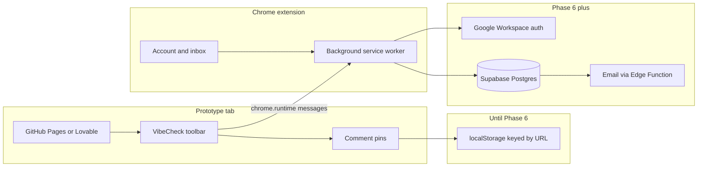

# Internal design-handoff Chrome extension

> Clone VisBug locally as the foundation, then add a collaboration layer in small testable phases — frontend first (localStorage), backend later (Supabase + Google Workspace SSO).

## What you are actually building

VisBug is already a **on-page design inspector**. It does **none** of the collaboration work. VibeCheck adds comments, annotations, AI prompt export, and content-approval on top — without rewriting VisBug.

**Why the service worker talks to Supabase, not the injected toolbar:** pages like Lovable can block network calls from scripts on the page (CSP). The extension background is allowed to call your API. The toolbar only sends messages like "save this comment".

---

## Decisions already made

- **Base:** [GoogleChromeLabs/ProjectVisBug](https://github.com/GoogleChromeLabs/ProjectVisBug) (Apache-2.0, Manifest V3, JavaScript, custom elements).
- **Product name:** VibeCheck.
- **Frontend-first:** comments, annotations, and content suggestions ship against **localStorage** (keyed by normalized prototype URL). Not cookies.
- **Comments + annotations:** one toolbar button (hotkey **C**). Type is chosen in the composer (Note vs Annotation for devs).
- **Login (later):** Google Workspace SSO via Supabase Auth, restricted to the company email domain.
- **Backend (later):** Supabase. Swap the storage adapter; do not rewrite the UI.
- **GitHub:** private repo https://github.com/grzegorzkrzton/design-feedback-tool

---

## Phase checklist

- [x] **Phase 0** — Clone ProjectVisBug, load unpacked, verify Alt+Shift+D
- [x] **Phase 1** — Private GitHub repo, Apache-2.0 attribution, VibeCheck rebrand
- [x] **Phase 2** — Copy AI prompt tool (Q) from live edits (no backend)
- [x] **Phase 3** — Figma-like comment notes, localStorage, orphaned fallback
- [x] **Phase 4** — Annotation type in the same composer, filters, distinct callouts
- [x] **Phase 5** — Content suggestions with local preview / approve / reject
- [x] **Phase 6** — Storage adapter + account popup + schema; connect your Supabase project to go live
- [x] **Phase 7** — Mentions, local inbox, reply threads; email after SSO

---

## How we work

1. One phase at a time.
2. Implement → push to `origin/main` → test PC runs `git pull` → reload unpacked.
3. Confirm the phase before starting the next one.
4. Comments do **not** sync across computers until Phase 6. That is expected.

---

## Phase 2 — Copy AI prompt (done)

Toolbar action **Q** copies a structured prompt of live visual/content edits. No login.

---

## Phase 3 — Figma-like comments (local)

**Done when:** on one prototype URL, you can pin a note on a selected element, reload the page, and the pin is still there in that Chrome profile.

- One **Comment** toolbar mode (hotkey **C**).
- Click uses existing `Selectable`, then opens a pin + composer.
- Persist `{ id, type: 'note', body, anchor, resolved, createdAt, authorName }` in localStorage via a storage adapter.
- Reuse `createAnchor()` from Phase 2.
- On load: selector → text+tag fallback → **orphaned** item in the list if the DOM moved.
- Resolve / delete. No threads in the first slice (replies land in Phase 7).
- Display name stored locally (default `You`).

---

## Phase 4 — Engineer annotations (same button)

**Done when:** the Comment composer can create a dev annotation, it looks different on the page, and you can filter notes vs annotations.

- Type control in the same box: **Note** vs **Annotation for devs**.
- Annotation subtypes: implement / warning / question.
- Distinct pin/callout styling. Filter: Notes / Annotations / All.
- Same records, `type: 'annotation'`. No second toolbar icon.

---

## Phase 5 — Content suggestions (local)

**Done when:** you can select text, propose replacement copy, preview it on the page, and approve or reject it locally.

- New **Content** tool (hotkey **W**).
- Store suggestions in the same adapter.
- You act as owner on this machine. No email.

---

## Phase 6 — Supabase + Google Workspace SSO

**Done when:** work Google login works, and comments/annotations/suggestions for a URL load from Postgres for signed-in teammates.

- Popup + `chrome.identity` + domain-restricted Google provider.
- All Supabase calls from the **service worker**.
- Tables: `profiles`, `prototypes`, `comments` (include `type`), `content_suggestions`, `notifications`.
- Swap the storage adapter from local to remote. Optional import of localStorage data.
- Session in `chrome.storage.local`, not on the host page.

---

## Phase 7 — Notifications and team rollout

Mentions that notify, inbox + email, thread replies, tester zip / admin install — after dogfooding Phases 3–6.

---

## What we will not do in the first months

- Full Figma parity (version history, branching, FigJam-like canvas)
- Editing the actual Lovable/GitHub source (the AI prompt is the handoff)
- Public Chrome Web Store listing
- Rewriting VisBug into React/TypeScript
